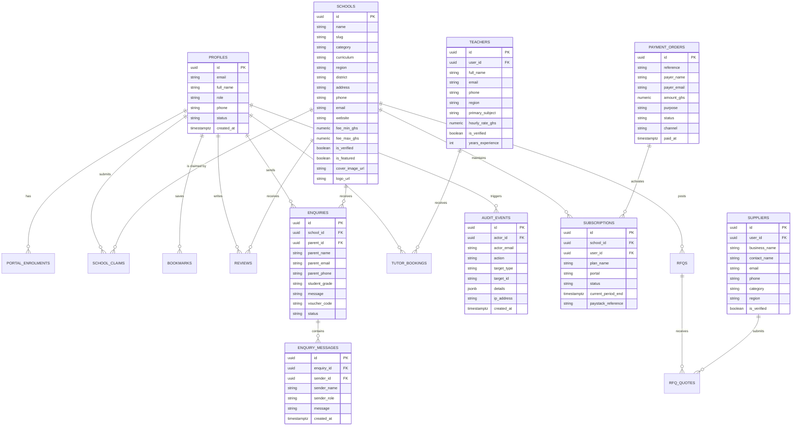

# SkoolFinder Ghana - Database Schema & ERD Documentation

This document provides the authoritative database reference for SkoolFinder Ghana across all 5 architecture phases.

---

## 1. Entity-Relationship Diagram (ERD)

---

## 2. Table Catalog & Schema Dictionary

### 2.1 Core Identity & Directory Tables (Phase 1 & 2)

#### `public.profiles`
- Primary identity table mirroring Supabase `auth.users`.
- Key columns: `id (UUID PK)`, `email (VARCHAR)`, `full_name (VARCHAR)`, `role (VARCHAR: 'parent' | 'school' | 'teacher' | 'supplier' | 'admin')`, `phone (VARCHAR)`, `status (VARCHAR: 'active' | 'suspended')`.
- RLS: Public read, users can update their own row, Service Role has full access.

#### `public.schools`
- Comprehensive repository of verified Ghanaian schools.
- Key columns: `id (UUID PK)`, `name (VARCHAR)`, `slug (VARCHAR UNIQUE)`, `category (VARCHAR: 'Primary' | 'JHS' | 'SHS' | 'International' | 'Montessori')`, `curriculum (VARCHAR: 'GES' | 'Cambridge' | 'IB' | 'Montessori')`, `region (VARCHAR)`, `district (VARCHAR)`, `phone (VARCHAR)`, `email (VARCHAR)`, `fee_min_ghs (NUMERIC)`, `fee_max_ghs (NUMERIC)`, `is_verified (BOOLEAN)`, `is_featured (BOOLEAN)`.
- Indexes: `idx_schools_region`, `idx_schools_category`, `idx_schools_verified`.

#### `public.teachers`
- Private tutors and verified Ghana educators.
- Key columns: `id (UUID PK)`, `user_id (UUID FK profiles)`, `full_name (VARCHAR)`, `primary_subject (VARCHAR)`, `region (VARCHAR)`, `hourly_rate_ghs (NUMERIC)`, `is_verified (BOOLEAN)`.

#### `public.suppliers`
- Vetted educational vendors, equipment suppliers, uniform manufacturers, and textbook distributors.
- Key columns: `id (UUID PK)`, `user_id (UUID FK profiles)`, `business_name (VARCHAR)`, `category (VARCHAR)`, `region (VARCHAR)`, `is_verified (BOOLEAN)`.

---

### 2.2 Parent Engagements & Admissions (Phase 2 & 3)

#### `public.enquiries`
- Inbound inquiries from prospective parents to schools.
- Key columns: `id (UUID PK)`, `school_id (UUID FK schools)`, `parent_name (VARCHAR)`, `parent_email (VARCHAR)`, `student_grade (VARCHAR)`, `voucher_code (VARCHAR: 'SCH-XXXXXX')`, `status (VARCHAR: 'new' | 'replied' | 'enrolled')`.

#### `public.enquiry_messages`
- Two-way communication thread between school admissions officers and parents.
- Key columns: `id (UUID PK)`, `enquiry_id (UUID FK enquiries)`, `sender_name (VARCHAR)`, `sender_role (VARCHAR)`, `message (TEXT)`.

#### `public.tutor_bookings`
- Lesson and consultation booking requests submitted by parents to verified tutors.
- Key columns: `id (UUID PK)`, `teacher_id (UUID FK teachers)`, `parent_name (VARCHAR)`, `parent_email (VARCHAR)`, `subject (VARCHAR)`, `hours_per_week (INT)`, `status (VARCHAR: 'pending' | 'confirmed' | 'declined')`.

#### `public.email_logs`
- Delivery log tracking all transactional email dispatches across all 4 user portals.
- Key columns: `id (UUID PK)`, `recipient_email (VARCHAR)`, `template_name (VARCHAR)`, `portal (VARCHAR)`, `status (VARCHAR: 'sent' | 'simulated' | 'failed')`.

---

### 2.3 Payments, Subscriptions & Governance (Phase 4 & 5)

#### `public.plans`
- Active subscription packages denominated in Ghana Cedis (GHS).
- Seeded tiers: `Verified Campus Partner` (GH₵ 1,200), `Featured Leader Spotlight` (GH₵ 2,500), `Pro Educator Membership` (GH₵ 350), `Verified Wholesale Supplier` (GH₵ 600).

#### `public.payment_orders`
- Ledger of all Paystack Mobile Money and Card payment attempts and receipts.
- Key columns: `id (UUID PK)`, `reference (VARCHAR UNIQUE)`, `payer_name (VARCHAR)`, `amount_ghs (NUMERIC)`, `purpose (VARCHAR)`, `status (VARCHAR: 'pending' | 'success')`, `channel (VARCHAR)`, `paid_at (TIMESTAMPTZ)`.

#### `public.subscriptions`
- Institutional membership status and validity periods.
- Key columns: `id (UUID PK)`, `school_id (UUID FK schools)`, `plan_name (VARCHAR)`, `status (VARCHAR: 'active' | 'expired')`, `current_period_end (TIMESTAMPTZ)`.

#### `public.audit_events`
- Tamper-evident log of administrative approvals, license verifications, and user account actions.
- Key columns: `id (UUID PK)`, `actor_email (VARCHAR)`, `action (VARCHAR)`, `target_type (VARCHAR)`, `target_id (VARCHAR)`, `details (JSONB)`, `ip_address (VARCHAR)`.

---

## 3. Migration Guide

All migrations are designed to be idempotent (`IF NOT EXISTS` / `ON CONFLICT DO NOTHING`). They can be applied in the Supabase SQL Editor in the following order:

1. `sql/setup_full_database.sql` - Core schema, initial profiles, schools, teachers, suppliers, and seed dataset.
2. `sql/phase3_tables.sql` - Email logs, notifications, inquiry message threads, tutor bookings.
3. `sql/phase4_and_5_tables.sql` - Paystack payment orders, subscriptions, subscription plans, and audit logging.
