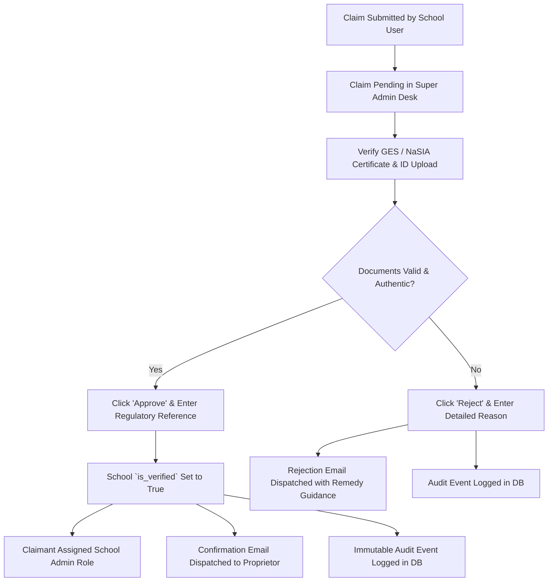

# SkoolFinder Ghana - Administrator & Operations Runbook

This runbook outlines operational procedures for SkoolFinder platform administrators, regulatory officers, and support staff.

---

## 1. Regulatory Governance & Claim Verification

SkoolFinder Ghana connects thousands of Ghanaian families with vetted basic, secondary, and international institutions. Maintaining trust requires strict adherence to institutional verification standards.

### 1.1 Acceptable Regulatory Credentials
To receive the **"Verified Campus"** checkmark badge, an institution or its authorized representative must present valid documentation from one or more of the following bodies:
1. **National Schools Inspectorate Authority (NaSIA)**
   - Certificate of School Registration / School Establishment Approval.
   - School Licensing Inspection Report.
2. **Ghana Education Service (GES)**
   - District / Regional Education Directorate Approval Letter.
   - GES Registration Number.
3. **Registrar General's Department (RGD)**
   - Certificate of Incorporation / Certificate to Commence Business.
4. **International Examining Bodies (where applicable)**
   - Cambridge Assessment International Education (CAIE) Centre Number.
   - International Baccalaureate (IB) World School Authorization.

---

## 2. Institutional Claims Adjudication Workflow

When a school proprietor, headmaster, or administrator submits a claim for a listed institution:



### 2.1 Adjudication Steps in Super Admin Console
1. Log into SkoolFinder as a **Super Administrator** and open the **Super Admin Console** (`/admin`).
2. Navigate to the **Claims Decision Desk** tab (`/api/admin/claims`).
3. Inspect pending claims:
   - Check the applicant's official work email and phone number.
   - Verify the uploaded registration/license document in the Supabase Storage viewer.
   - Cross-reference the school name with the GES/NaSIA registered database.
4. **To Approve:**
   - Click **Approve Claim**.
   - Input the verified accreditation reference (e.g. `NaSIA/GAR/2026/0491`).
   - The platform will atomically toggle `schools.is_verified = true`, link the profile as an authorized proprietor, send an approval notification email, and record an event in `audit_events`.
5. **To Reject:**
   - Click **Reject Claim**.
   - Provide a clear, polite explanation (e.g., *"Document illegible; please upload a scanned copy of your 2025/2026 NaSIA renewal certificate"*).
   - The user receives an actionable email explaining how to resubmit.

---

## 3. Paystack Subscriptions & Revenue Operations

### 3.1 Monetization Packages (Ghana Cedis GHS)
| Plan Name | Slug | Annual Price | Target Group | Primary Entitlements |
|---|---|---|---|---|
| **Verified Campus Partner** | `school-verified` | GH₵ 1,200.00 | K-12 Schools | Verified Checkmark, WhatsApp Lead Button, Inquiry Inbox |
| **Featured Leader Spotlight** | `school-featured` | GH₵ 2,500.00 | Top Tier Schools | Top 3 Homepage Placement, Priority Admissions, RFQ Board |
| **Pro Educator Membership** | `teacher-pro` | GH₵ 350.00 | Private Tutors | Verified Tutor Badge, Direct Lesson Booking Alerts |
| **Verified Wholesale Supplier** | `supplier-verified` | GH₵ 600.00 | School Vendors | Ghana B2B Badge, School Board RFQ Quoting Access |

### 3.2 Payment Verification & Instant Entitlement
- All payments are routed through Paystack Ghana supporting MTN Mobile Money, Telecel Cash, AT Money, and Cards.
- Verification occurs automatically via `/api/payments/verify` or via cryptographic HMAC SHA512 webhooks at `/api/payments/webhook`.
- If a school pays via direct MoMo or bank transfer off-platform, a Super Admin can manually grant verification through the console.

### 3.3 Official Electronic Receipts
Every successful transaction generates an official electronic receipt reference `REC-XXXXXXXX` accessible via:
```
GET /api/payments/receipt/:reference
```
Receipts can be printed or saved to PDF by proprietors for institutional accounting.

---

## 4. User Moderation & Fraud Prevention

### 4.1 Account Status Control
Administrators can suspend fraudulent actors or bad faith listings:
- **Active (`active`)**: Full portal access.
- **Suspended (`suspended`)**: Token rejected with HTTP 403 `Account suspended. Contact administration.`

### 4.2 Rate Limiting Protection
To safeguard against DDoS attacks, scraper bots, and credential stuffing:
- **Auth & Payments Endpoints**: Limited to **20 requests per 15 minutes** per IP.
- **Public API Endpoints**: Limited to **120 requests per minute** per IP.

### 4.3 Immutable Audit Trail
Every security-critical administrative action is logged to the `audit_events` table:
- Actor user ID and email
- Action type (`claim_approved`, `claim_rejected`, `school_verified`, `user_suspended`)
- Target entity type and ID
- Administrative justification notes
- Remote client IP address
- Timestamp (UTC)

Audit logs can be reviewed in real-time at `GET /api/admin/audit-logs`.

